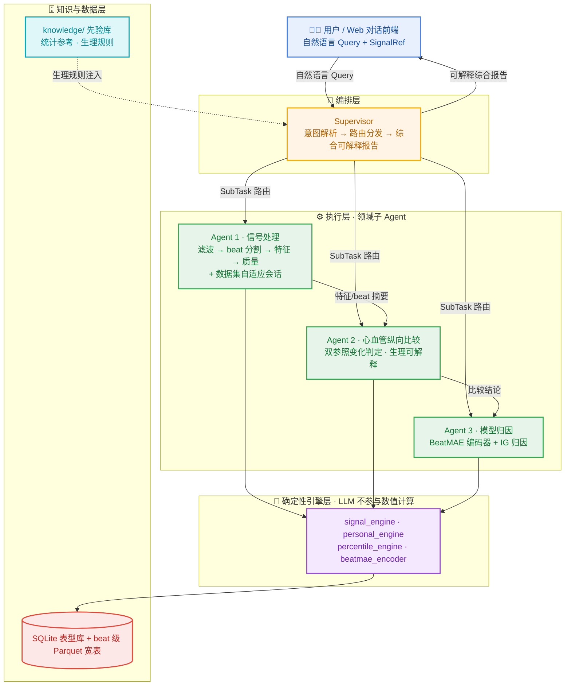

# PPG-Agent

> 一个由 LLM 驱动的**多智能体 PPG（光电容积脉搏波）心血管信号理解框架**：自然语言提问，系统自动完成"信号处理 → 纵向比较分析 → 模型归因 → 可解释报告"的完整链路。

面向可穿戴 / 动态血压场景下的 PPG 信号，把**确定性信号引擎**与**大模型推理编排**分层解耦，产出**生理可解释、证据可追溯**的分析结论，并提供 Web 对话界面与轻量公网部署方案。

---

## ✨ 亮点

- **多智能体编排**：Supervisor（意图解析 / 路由 / 综合）+ 3 个领域子 Agent，基于 LangGraph 状态机协作。
- **确定性引擎 + LLM 分离**：所有数值计算（滤波、beat 分割、特征提取、纵向统计）走纯 Python 引擎；LLM 只做调度与表达，**原始波形永不进 LLM**，只传结构化摘要。
- **Schema 驱动**：Agent 间全部用 Pydantic v2 严格契约传递，杜绝裸 dict/str，保证可追溯。
- **纵向个人比较**：以"本人历史基线 + 近 N 段"双参照做变化判定（MDC / 个人 3σ-MAD 阈值），并在 held-out 数据上做过滑动游走验证。
- **模型归因可解释**：beat 级 MAE 预训练编码器 + 梯度归因，把预测落到特征点级别。
- **异构 LLM**：本地 vLLM（Qwen2.5-14B）与云端 DeepSeek 通过统一 `AgentService` 按角色调度。
- **可交付**：FastAPI + React 对话界面；一套 `nginx + frp + Caddy + systemd` 的"云机薄壳 / 全栈留本地"公网部署方案。

---

## 🏗️ 架构总览



三条贯穿性设计原则：
1. **LLM 只做调度与表达**，数值全部走确定性引擎；
2. **原始波形永不进 LLM**，跨 Agent 只传统计摘要与特征；
3. **状态请求级隔离**（`contextvars` + `RunnableConfig`），并发分析互不污染。

---

## 🤖 Agent 分工

| Agent | 模块 | 职责 | 关键工具 / 能力 |
|---|---|---|---|
| **Supervisor** | `agents/supervisor.py` | 意图解析 → 任务分解 → 路由 → 综合报告 | `SupervisorPlan` / `SubTask`；知识注入 |
| **Agent 1 · 信号处理** | `agents/signal_processor_agent.py` | 信号加载 → 预处理 → beat 分割 → 特征提取 → 质量评估 | `signal_engine`（VitalPy 封装）；6 个只读工具 |
| **Agent 1 · 适配分支** | `agents/adaptation_session.py` | 数据集参数自适应（diagnose→propose→apply→validate→finalize） | 分半信度 + 符号对齐验收门禁 |
| **Agent 2 · 心血管分析** | `agents/cardiovascular_agent.py` | 纵向个人比较、变化判定、生理可解释 | `personal_engine.compare_segment`；`CompareReport`/`Findings` |
| **Agent 3 · ML 预测** | `agents/ml_prediction_agent.py` | beat 级预训练推理 + 归因 | MAE encoder + Integrated Gradients |

---

## 📂 代码结构

```
ppg_agent/            # 主包
├── agents/           # Supervisor + 3 子 Agent + 适配会话
├── engine/           # 确定性引擎：signal / personal / percentile / visualization
├── schemas/          # Pydantic v2 数据契约（SignalRef / SegmentFeatures / Evidence …）
├── knowledge/        # KnowledgeBase（统计参考）+ RuleEngine（生理规则）
├── database/         # SQLite schema 与迁移
├── config.py         # 路径 / 数据集配置（支持 PPG_DATA_ROOT 环境变量覆盖）
├── llm_service.py    # AgentService：多模型统一调度
└── context.py        # PPGContext：请求级共享状态
web/
├── api/              # FastAPI（chat / data / analysis 路由 + services）
└── frontend/         # React + Vite 对话界面
knowledge/            # JSON 先验知识库（聚合统计 / 相关性 / 规则）
models/               # 模型注册表 + prompts（真实密钥走环境变量）
deploy/               # 公网部署：nginx + frp + Caddy + systemd
tests/                # 单元 / 集成测试
docs/                 # 架构文档
```

---

## 🚀 快速开始

> ⚠️ **数据说明**：本项目分析基于 **MIMIC-III / VitalDB / Anker ABPM** 等受**数据使用协议（DUA）**约束的临床数据集，**不随仓库分发**。需自行获取授权数据并通过 `PPG_DATA_ROOT` 指定路径。

**依赖**：Python 3.10+、Node 18+（后端见 `requirements.txt`、前端见 `web/frontend/package.json`）；LLM 后端可选本地 vLLM 或 DeepSeek API。

> 🔗 **外部模型依赖**：Agent 3 的 **BeatMAE** 编码器是**独立研究仓、不随本仓库分发**——将 BeatMAE clone 到 `external/BeatMAE`（或设 `BEATMAE_ROOT`）即可接入；权重由 `engine/weights.py` 从 Zenodo 版本化 DOI 自动下载并校验缓存。仓库内含 Agent 侧装配壳（`engine/beatmae_encoder.py`），BeatMAE 源码零改动。

> 🔗 **信号库依赖**：Agent 1 的 beat 分割/特征提取依赖同级本地包 **VitalPy**（`pip install -e /path/to/VitalPy`）。

```bash
# 1) 配置模型注册表（复制模板后填 key）
cp models/model_registry.example.yaml models/model_registry.yaml
export DEEPSEEK_API_KEY=sk-xxxx            # 或本地 vLLM 端点

# 2) 后端
pip install -r requirements.txt            # 若未提供，按 import 自行安装
export PPG_DATA_ROOT=/path/to/data_v2
python -m uvicorn web.api.main:app --host 127.0.0.1 --port 8000

# 3) 前端
cd web/frontend && npm install && npm run dev
```

---

## 🌐 部署方案

采用 **"全栈留本地、云机做薄壳"** 的反向隧道架构，兼顾演示可达性与数据/密钥安全：

```
公网 → 云机 nginx:80 → frps:7000 → [出站加密隧道] → 本机 frpc → Caddy:8088 → uvicorn:8000
```

- 数据、密钥、GPU 全部留在本地，云机不存任何敏感内容；
- 隧道由本机**主动出站**发起，本机对云机"只出不进"，防跳板；
- 配置与安装脚本见 `deploy/`（含 `*.toml.example` 模板与双账号安装脚本）。

---

## 📜 许可

本项目代码**保留所有权利（All Rights Reserved）**，未经许可不得用于商业用途。底层数据集受各自 DUA 约束，不在本仓库分发范围内。
