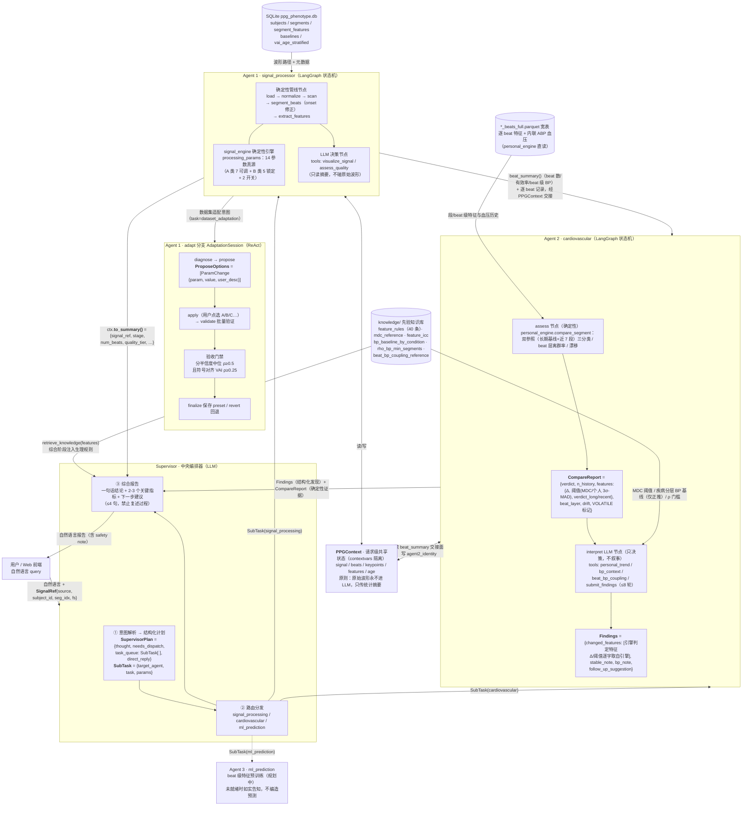
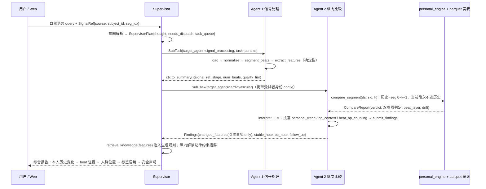

# PPG-Agent 多智能体架构图

> 生成日期：2026-08-18；Agent 2 分层比较引擎重构后更新：2026-08-21
> 用途：汇报 PPT 架构图素材（Mermaid 源码，可渲染后截图或直接重绘）
> 依据代码：`ppg_agent/agents/{supervisor,signal_processor_agent,cardiovascular_agent,adaptation_agent}.py`

---

## 图 1：总体架构（含子 Agent 内部结构与共享基础设施）

---

## 图 2：一次完整分析的结构化消息时序

---

## 结构化消息速查表（PPT 标注用）

| 消息 | 产生方 → 消费方 | 内容 |
|------|----------------|------|
| `SignalRef` | 用户 → Supervisor | `{source, subject_id, seg_idx, fs, duration_sec}`，全流程唯一入口 |
| `SupervisorPlan` | Supervisor 内部 | `{thought, needs_dispatch, task_queue, direct_reply}` |
| `SubTask` | Supervisor → 子 Agent | `{target_agent, task(人类可读描述), params(路由参数)}` |
| `to_summary()` | Agent 1 → Supervisor | 上下文摘要：阶段状态、beat 数、质量分层——**不含波形数据** |
| `beat_summary()` | Agent 1 → Agent 2 | 当前段 beat 数/有效率/beat 级 BP 中位，经 PPGContext 交接，与引擎 beat 层交叉校验 |
| `CompareReport` | Agent 2 内部（personal_engine 输出） | verdict 门控（ok/no_history/insufficient_history/低质量）、双参照三分类、beat 层离群率、漂移、VOLATILE 标记 |
| `Findings` | Agent 2 → Supervisor | 引擎判 real_change 的特征（Δ/阈值/方向逐字取自引擎）+ 稳定性注记 + 血压语境 + 随访建议；Agent 2 不产散文，措辞归 Supervisor |
| `ProposeOptions` | 适配会话 → 用户 | `[ParamChange{param, value, user_desc}]`，规则生成 + LLM 兜底 |
| 知识注入 | knowledge/ → Supervisor | `retrieve_knowledge(features)`：特征→生理方向的规则文本 |

## Agent 2 能力证据状态（纵向比较引擎，test 集滑动游走验证，2026-08）

范式：train 拟合人群先验（knowledge/ JSON）→ test 集滑动游走验证（vital 429 人全量 + mimic 抽 120 人，对数间隔评估点，复现运行时同款语义）。
协议与全部数值见 `analysis/10_heldout_validation/02_longitudinal_validate.py`（`output/longitudinal_summary.csv` + `longitudinal_report.json`）。

| 能力 | 证据状态 | held-out 关键数值 | 处置 |
|------|---------|------------------|------|
| 变化判定（个人 3σ-MAD/MDC 双参照） | ✅ test-validated | 中位误报率 vital 0.058 / mimic 0.026（250 万次判定）；但 8 特征 FP>10%（kurtosis 0.354 等） | 保留；8 高波动特征标 VOLATILE 叙事降级 |
| beat 层离群率 | ✅ test-validated | 中位 0.0（两库，3σ 围栏特异优先） | 保留 |
| beat×BP 耦合 | ✅ test-validated | 相邻段符号一致率 vital 0.68–0.79 / mimic 0.70–0.80 | 保留（体系最稳信号，去混杂版为权威） |
| 百分位校准（人群位置） | ✅ vital / ⚠️ mimic | frac_above_p50：vital 0.4835 达标；mimic 0.5676 略超上界（ICU 人群漂移，记录在案） | 仅 ICC≥0.6 特征输出，其余 suppressed |
| 个人内 ρ(feature,BP) | ⚠️ 弱参考 | split-half 符号一致率 0.64–0.70 未达 0.70 | 门槛 ≥20 段；只能以「弱相关」措辞引用 |
| 疾病×BP 分层基线 | ⚠️ 仅正推 | 受试者中位口径 mimic 分离 11.9mmHg 达标；vital 2.9（术前降压药控制的临床现实） | 已知标签 → 该组 BP 分布的正推描述；严禁反推疾病 |
| 热身门槛（历史长度敏感性） | ℹ️ 阴性发现 | FP 对历史长度几乎平坦（3→50 段：vital 0.073→0.077） | compare ≥3 段门槛维持，ρ 类统计坚持 ≥20 段 |
| VAI / 表型亚型 / 疾病关联 / interpretation_rules / window_assess | ❌ 已证伪或降级 | 疾病关联方向复现率≈随机；VAI 等纵向场景不适用 | 已从 Agent 2 与前端展示移除（compute_vai 保留供 analysis/ 复现脚本；百分位等描述性报告路径保留） |

## 三条贯穿性设计原则（图注脚）

1. **LLM 只做调度与表达**：所有数值计算走确定性引擎（signal_engine / personal_engine），Agent 2 只决策分析路径，叙事归 Supervisor
2. **原始波形永不进 LLM**：跨 Agent 只传结构化摘要与特征统计量
3. **状态请求级隔离**：PPGContext 基于 contextvars，并发分析互不污染；跨节点→工具的状态走 RunnableConfig.configurable（ToolNode 线程池不传播 contextvars）
