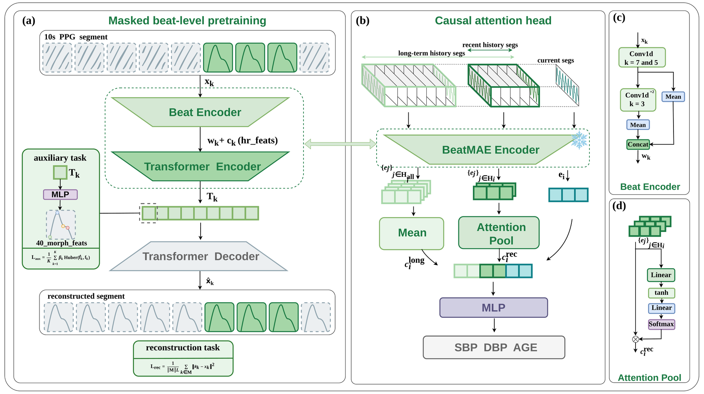

# BeatMAE

**Beat-aligned masked pre-training and longitudinal context representation for PPG-based physiological estimation.**



*Figure 1. (a) Beat-level masked pretraining: a shared CNN encodes individual beats, augmented
with heart-rate and onset features, before a Transformer reconstructs masked beats under an
auxiliary morphology loss. (b) Causal attention head: the current embedding is regressed
alongside a recent-window attention pool and a running mean of preceding segments.
(c) Beat encoder. (d) Attention pool.*

---

## The paper

> **BeatMAE: Beat-Aligned Masked Pre-Training and Longitudinal Context Representation for
> PPG-Based Physiological Estimation**

### Abstract

Self-supervised pretraining has advanced photoplethysmography (PPG) representation learning,
yet existing methods typically mask fixed temporal patches that can split cardiac cycles and
estimate segments independently, without considering subject-specific history. We propose
BeatMAE, a beat-aligned pretraining framework that represents each heartbeat as a token and
masks complete beats, using waveform reconstruction and a morphology-aware loss to preserve
beat-level information. For downstream estimation, a longitudinal causal attention head
integrates the current segment with recent observations and a running summary of the same
subject's preceding segments. Pretrained on 3.83 million segments from 4,832 subjects, the
frozen BeatMAE encoder achieves the lowest mean absolute error among six pretrained encoders
for systolic blood pressure (SBP), diastolic blood pressure (DBP), and age on VitalDB and
Aurora-BP, including SBP errors of 8.78 and 11.79 mmHg and age errors of 5.17 and 5.75 years,
respectively. The causal attention head reduces error across five other pretrained encoders,
with improvements that generally increase as subject history accumulates. On a wrist-PPG domain
excluded from pretraining, BeatMAE attains SBP and DBP errors of 8.19 and 7.30 mmHg. These
results demonstrate that cardiac-cycle-aligned pretraining and causal longitudinal context
provide an effective framework for personalized physiological estimation.

**Index terms** — self-supervised pretraining, masked autoencoder, causal attention, cuffless
blood pressure

### Contributions

1. **BeatMAE**, a beat-level self-supervised pretraining framework for PPG that combines
   one-token-per-beat representation, whole-beat masking, mask-invariant heart-rate
   information, and a 40-dimensional morphological auxiliary regression objective.
2. **A longitudinal causal attention head**, a plug-and-play prediction module that integrates
   the current segment with recent and historical subject context.
3. **Extensive evaluation** across clinical and wearable PPG domains, showing consistent
   improvements over existing pretrained models and improved transfer to an unseen wrist-PPG
   domain. We further quantify the effect of pretraining-domain exposure, showing that broader
   and more clinically diverse source data progressively improve downstream transfer.

---

## What this repository is

A **reproduction package** for the paper: research code, reproduction configs, and the
generation chain for every result table and figure.

It covers segment-level self-supervised pretraining on a four-source PPG corpus plus the
downstream training/evaluation protocol. Pretraining is masked reconstruction in the MAE
family — with PaPaGei as one exception, which uses morphology-pseudo-label-guided contrastive
learning. BeatMAE additionally attaches a **40-dimensional per-beat auxiliary regression**
(ICC-weighted, z-parameterized). Downstream, the encoder is frozen and only a lightweight
probe head is trained; evaluation is at the **segment level**, reporting MAE and Pearson *r*.

> The corpus and training artifacts are **not** in the repository, for size and licensing
> reasons — see [Known limitations](#known-limitations).

## Models

| Family | Pretraining entry point | Notes |
|---|---|---|
| **BeatMAE** | `train/pretrain.py` | The paper's model. Beat-level tokenization; masked beats are replaced wholesale by a mask token. `RegionMasker` has five modes (`unified` / `weighted` / `hybrid` / `beat_drop` / **`anchor`**); the main model uses `anchor` — mask whole beats while keeping one contiguous visible anchor, a strategy adopted from xMAE. Loss = reconstruction MSE + auxiliary per-beat feature regression (ICC-weighted SmoothL1). Optional V3-B beat-morphology discrete-code CE. |
| HiMAE | `train/pretrain_baseline.py` | Baseline. Concatenates beats into a fixed-length waveform, then patch-level random masked reconstruction (patch 16, mask 65%). For the `raw_waveform` variant, pass `baseline.input_mode=raw_waveform` + `baseline.patch_len`; `seg_len` then becomes 1250, taking 5/25/50 for the three families respectively. |
| MMR | as above | Baseline. Reconstruction target is the **DWT wavelet coefficients** of masked patches (asymmetric ViT MAE). |
| xMAE | as above | Baseline. The original reconstructs masked ECG from PPG; without ECG it degenerates to PPG self-masked reconstruction. |
| PaPaGei P/S | `train/pretrain_papagei.py` | Baseline. 1D-ResNet (P) / 3-expert MoE (S), 512-dim output. Positive pairs via sVRI equal-width binning (8 bins), NT-Xent loss (τ = 0.07); S additionally regresses ipa/skewness. Morphology pseudo-labels are precomputed by `scripts/compute_morphology.py`. It has no masking and no patchification, so it gets its own entry point. |

Downstream probe heads live in `models/probe_heads/`: `causal_stream.py` (segment-level
streaming — the protocol used for the paper's results), `mlp.py`, and `attn_pool.py`.

## Repository layout

| Directory | Contents |
|---|---|
| `preprocess/features/` | **40-dim per-beat morphological feature extraction** (raw PPG segment → 9 keypoints + 40 features). The only runnable part of `preprocess/`; entry point `scripts/extract_beat_features.py` |
| `preprocess/corpus_build/` | The 6 corpus-build stages — **a record, not a tool**: they depend on a private 4.8 GB phenotype database and on gated raw data, so they cannot run. Kept so readers can see what processing the corpus went through |
| `third_party/vitalpy/` | **VitalPy-derived code** (GPL-3.0), the core of the 40-dim computation. Provenance, modification list and citation in that directory's README. **This is why the repository is GPL-3.0** |
| `results/paper/` | **The paper's result tables and figures**, one subdirectory per experiment. The canonical location for artifacts — `tools/` writes there directly |
| `results/` (rest) | Training artifact tree: weights, embedding caches, predictions. **Not version-controlled** — `results/paper/` is the only tracked subtree |
| `data/` | Dataset and sampling: `corpus_dataset.py` (memmap reader), `samplers.py` (source balancing), `windows.py` (windowing), `region_mask.py`, `beat_ops.py`, `paths.py` (corpus root resolution) |
| `models/` | **This paper's model side**: `beat_mae/` (BeatMAE) + `common/` (transformer / losses / encoding / regions) + `probe_heads/` (downstream probe heads) |
| `baselines/` | **Comparison models** (`himae` / `mmr` / `xmae` / `papagei`) — reproductions from the papers and public implementations, not contributions of this work and not the authors' official code. Per-family provenance and upstream licensing are documented in that directory's README |
| `train/` | `pretrain.py` (BeatMAE), `pretrain_baseline.py` (himae/mmr/xmae), `pretrain_papagei.py` (PaPaGei), `probe.py` (embedding/extraction library), `stream_probe.py` (the segment-level streaming protocol itself), `run_meta.py` |
| `scripts/` | Pipeline scripts (unnumbered — see [Script index](#script-index)) |
| `eval/` | Orchestration layer: `run_campaign.py` + `example_workflow.sh` / `example_matrix.sh` |
| `tools/` | Streaming result analysis (`stream_pearson.py` / `stream_cross_eval.py` / `stream_dump_preds.py`), result-table generation (`make_paper_tables.py` / `make_data_tables.py`), shared protocol constants `_calibers.py`, ablation control `make_randinit_ckpt.py` |
| `results/paper/code/` | **Plotting code for the three content figures**: `make_content_figs.py` + style `_paper_style.py` + color-vision validation `_cvd.py` |
| `tests/` | pytest suite (7 files, guarding code correctness; model metrics live in `eval/`) |
| `config/` | Base yaml (model invariants) + campaign yaml + auxiliary-task statistics |
| `references/` | Copies of upstream reference implementations (HGCTNet / papagei / SigmaPPG / xMAE + `himae.md`, `mmr.md` notes). **Not version-controlled** (third-party code) — used when calibrating baseline settings; reproduction does not depend on it |

## Installation

Python 3.10 + PyTorch (CUDA).

```bash
pip install -r requirements.txt
```

Tests: `pytest -q` — 51 tests. The 12 that need the corpus **skip** when it is absent rather
than erroring (`39 passed, 12 skipped` without it). Every test file also supports direct
`python tests/<file>.py` script mode.

The corpus root is resolved by `data/paths.py`; override it across machines with the
`PPG_CORPUS_ROOT` environment variable.

## Reproduction

### 0. The 40-dim features (if you want to build features from raw PPG yourself)

```bash
python scripts/extract_beat_features.py --demo --out /tmp/beats.parquet   # self-check, no data needed
python scripts/extract_beat_features.py --input segs.npy --fs 500 --out beats.parquet
```

⚠ **The input PPG must already be filtered.** This pipeline does not filter; it expects a
0.25–10 Hz bandpassed, baseline-corrected 500 Hz signal. Handing it an unfiltered signal
produces wrong results **without raising an error**.

The output schema matches `KP_COLS + BEAT_FEAT_COLS` in
`preprocess/corpus_build/03_build_features.py` exactly, so it can be dropped in as that stage's
input. **To read how the features are computed**, see `third_party/vitalpy/`.

### 1. Corpus

**The corpus is not shipped and cannot be rebuilt from this repository.** Building it depends
on a private 4.8 GB phenotype database and on gated raw data (MIMIC requires PhysioNet
credentialing, Aurora requires an application), and it is missing two post-hoc fixes that have
since been removed. `preprocess/corpus_build/` preserves the full scripts as a **record of the
processing**; the **method overview is in `preprocess/README.md`** (folding rules, anomaly
exclusion, quality tiers).

Once you have a corpus, point at it with `corpus_root=` or `PPG_CORPUS_ROOT` (`data/paths.py`).

### 2. Pretraining

```bash
# BeatMAE (main model)
python train/pretrain.py config/base/beatmae.yaml \
    out_dir=results/pretrain/beatmae_v2/v2c_4src_mvaiwb/mr065_sqrt data.sources=null

# Comparison models (one base config each for himae / mmr / xmae)
python train/pretrain_baseline.py config/base/himae.yaml \
    data.sources=[aurora] out_dir=results/pretrain/himae/v2c_aurora/mr065_sqrt

# PaPaGei (one entry point for P/S, switched by papagei.model; prerequisite below)
python scripts/compute_morphology.py                  # morphology pseudo-label table (scipy)
python train/pretrain_papagei.py config/base/papagei.yaml \
    papagei.model=papagei_s data.sources=[mimic,vital,aurora] \
    out_dir=results/pretrain/papagei_s/v2c_3src_mva/full
```

`out_dir` is required and must point into the four-level weight tree
`results/pretrain/<family>/<corpus>/<variant>`. Base configs contain **no experiment-specific
fields**; all deltas are passed as command-line `key=value` overrides. Each run writes a
`run_meta.json` (effective config snapshot + git + environment), which is the authority for
reproduction.

### 3. Downstream segment-level evaluation

The full three-stage chain is in `eval/example_workflow.sh`. For campaign scale:

```bash
python eval/run_campaign.py config/campaign_example.yaml --dry-run   # inspect the commands first
python eval/run_campaign.py config/campaign_example.yaml
```

The equivalent manual invocation (`run_campaign.py` runs exactly these):

```bash
python scripts/extract_embeddings.py --name=<exp> --ckpt=<best.pt> --sources=<src> --kind=<kind>
# kind ∈ beatmae | himae | mmr | xmae | papagei (PaPaGei's P/S is inferred from the ckpt;
# embedding dim varies by family: 256 for the other four, 512 for PaPaGei — the probe head
# infers its input dim from the data, so no code change is needed)
python scripts/materialize_stream.py --exp=<exp> --npz=<embedding cache>
python scripts/probe_full_stream.py exp=<exp> dir=<materialized dir>   # main table ①: all-corpus folds
python scripts/probe_iwshi_bp_5fold.py ...                                # main table ②: within-domain 5-fold
```

### 4. Result tables and figures

The paper's tables and figures are generated from the artifact tree by scripts in `tools/`.
Regeneration order is in [`results/paper/README.md`](results/paper/README.md). The training
artifacts themselves (weights, embedding caches, prediction dumps) are not version-controlled.

## Script index

Script names are **unnumbered**. The **six** scripts form two chains, plus the feature
extractor used in step 0:

**Training/evaluation chain** (`eval/run_campaign.py` chains the first three)

| File | Purpose | Output |
|---|---|---|
| `scripts/extract_embeddings.py` | Extract segment embeddings from a ckpt | `results/cache/embeddings/*.npz` |
| `scripts/materialize_stream.py` | Stream data materialization: sort + group + cap-sample, written once | `results/cache/stream/<exp>/` |
| `scripts/probe_full_stream.py` | Segment-level streaming probe (all-corpus folds). The protocol itself is in `train/stream_probe.py`; this file is a thin entry point | `.../stream/{results.json,heads/,preds/}` |
| `scripts/probe_iwshi_bp_5fold.py` | Within-domain 5-fold on the in-house domain | as above, head files carry the fold number |

**Feature extraction** (step 0 above)

| File | Purpose | Output |
|---|---|---|
| `scripts/extract_beat_features.py` | Raw PPG segment → 9 keypoints + 40 morphological features | a parquet matching `03_build_features.py`'s schema |

**PaPaGei prerequisite chain** (needed only for PaPaGei pretraining; uncoupled from the other families)

| File | Purpose | Output |
|---|---|---|
| `scripts/compute_morphology.py` | Compute morphology pseudo-labels (svri / ipa / skewness …) from corpus waveforms, for PaPaGei's contrastive positives and auxiliary regression targets | `results/cache/morphology/morphology_v2c.parquet` |

> That table's path appears in **two** places — this script's `DEFAULT_OUT` and
> `config/base/papagei.yaml` under `morphology:`. The default will not match your machine;
> override both together.

> The `01–05` numbering under `preprocess/corpus_build/` is the pipeline stage order
> (01 folds → 02 corpus → 03 features → 04 register → 05 annotation).
> `compute_feat_stats.py` is unnumbered: it is a rerunnable statistic generator, not a stage.

## Where the results are

**The paper's result tables and figures are in `results/paper/`**, one subdirectory per
experiment (see that directory's README). That is the canonical location for artifacts;
scripts in `tools/` write there directly.

**Everything else under `results/` is a local artifact and is not version-controlled** — the
weight tree under `results/pretrain/**/`, the embedding caches, the prediction dumps, and the
internal ledger that records every run. Step 4 above regenerates them from the artifact tree.

## Pretrained weights

The corpus is not shippable, so **the weights are the only way to actually use BeatMAE**.
They are hosted on Zenodo:

> **DOI: [10.5281/zenodo.23080600](https://doi.org/10.5281/zenodo.23080600)**
> (concept DOI for all versions: [10.5281/zenodo.23080599](https://doi.org/10.5281/zenodo.23080599))

| File | Size | What it is |
|---|---|---|
| `beatmae_v25c3_s4.pt` | 22.8 MB | The pretrained encoder, seed 4 |
| `heads/{sbp,dbp,age}_causal_attn_s4.pt` | 1.7 MB | The downstream causal attention head, one per target |
| `README.md` | — | Model card: loading, input requirements, intended use |

Each head file carries its own normalisation constants (`mu` / `sd`), so no separate
statistics file is needed.

⚠ The released encoder is the training checkpoint with the Adam optimiser state and **all
training-time paths stripped** — 68 MB → 22.8 MB. The weights themselves are unchanged
(verified bit-identical, 163 tensors). Packaged by `tools/pack_weights.py`, which also
self-checks the output for leftover identifiers.

**Research use only — not a medical device.**

## Known limitations

1. **The corpus is not included.** You must prepare `corpus_v2c` yourself and override
   `corpus_root`; `config/base/beatmae.yaml`'s `reliability_json` (the ICC weights) similarly
   points outside the repository and must be supplied.
2. **Some rows of the main tables cannot be replayed.** The materialized data for several runs
   is no longer available — of the 17 rows in main table ①, 9 are replayable; of the 17 rows in
   main table ②, 13 are. Those rows come from the ledger record and were not independently
   re-verified; treat them with appropriate caution.
3. **Only the five tables listed above ship from `results/`.** Everything else — embedding
   caches, prediction dumps — is excluded from version control.
4. **The pretraining entry points do not validate `out_dir`.** If the target directory already
   exists and contains `ckpt/best.pt`, it will be **overwritten** — change `out_dir` before
   rerunning an experiment with the same name (see `config/README.md`).
5. **The corpus cannot be rebuilt from this repository.** `preprocess/corpus_build/` is a
   **record of the processing**, not a runnable tool: it depends on a private 4.8 GB phenotype
   database and gated raw data, and two post-hoc fixes it applies are not in the tree.
   Day-to-day training and evaluation read the corpus directly and do not go through this
   directory. `preprocess/features/` (40-dim feature extraction) is the one runnable part —
   see step 0 above.
6. **The 40-dim features require an already-filtered input.** `preprocess/features/` does no
   filtering (upstream placed that step at data loading). It needs a 0.25–10 Hz bandpassed,
   baseline-corrected 500 Hz signal, or the results are wrong and no error is raised.
7. **`ptt_ppg_ms` requires ECG R-peaks** and is `None` when they are absent (the other 39 dims
   are unaffected).

## License

**GPL-3.0** — full text in [LICENSE](LICENSE).

The license is dictated by `third_party/vitalpy/`, which is derived from **VitalPy**
(SCAI-Lab, ETH Zürich) and carries GPL-3.0. Its copyleft applies to the repository as a
whole.

## Third-party code

| Source | Location | License | Notes |
|---|---|---|---|
| **VitalPy** | `third_party/vitalpy/` | GPL-3.0 | The core of the 40-dim morphological feature computation. **Derivation notes, modification list and citation are in that directory's README** |
| PaPaGei | `baselines/papagei/*`, `scripts/compute_morphology.py` | BSD 3-Clause-Clear (© 2024 Nokia) | Compatible with GPL-3.0; attribution retained in each file's docstring |

For the VitalPy citation, see `third_party/vitalpy/README.md`.
